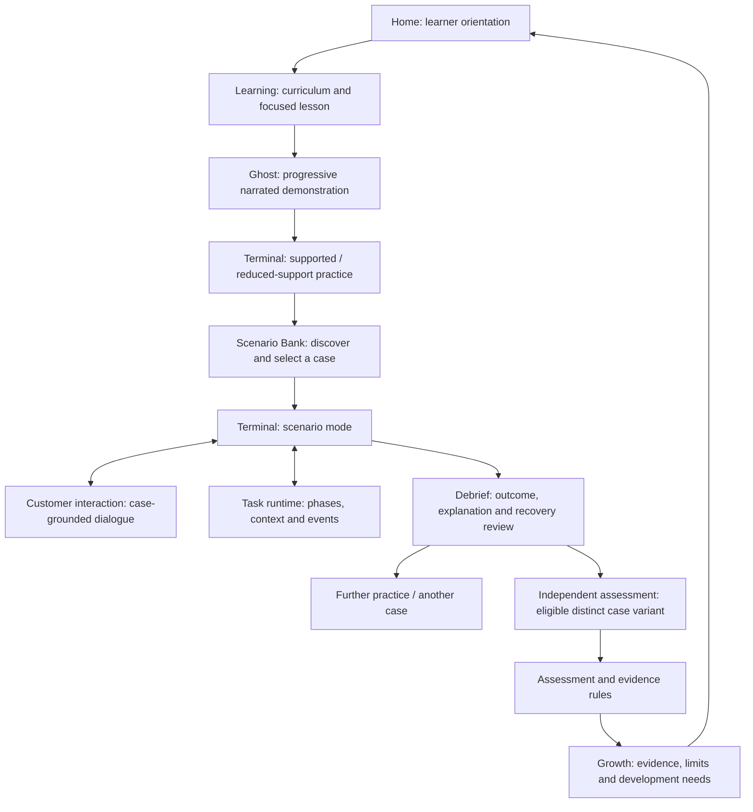

# DEIXEN — Unified Experience & Runtime Architecture

## Status and purpose

This document proposes one coherent architecture connecting the learner experience, Ghost Mode, Terminal, Scenario Bank, Coach, the customer interaction, the professional work-task lifecycle, assessment, evidence, Home, Learning, and Growth.

It is deliberately a **working architecture proposal**, not a new canonical decision, a replacement for D92/D97, a final UX specification, or permission to change code. Its purpose is to expose ownership boundaries, missing capabilities, dependencies, and decisions that need evidence before implementation.

### Sources and boundaries

This proposal is aligned with:

- the current five-area product structure and current Home naming in `03_DEIXEN_Canonical_Product_and_Architecture.md`;
- D92: Scenario Bank is the case/library experience; scenario execution occurs inside Terminal;
- D97: cumulative Ghost exposure, no state injection, and isolated independent-workflow assessment;
- the current strategic brief's three connected but distinct lifecycles;
- the current UX, Product Design Language, Brand Strategy, and UI Specification planning documents in this package.

It does not rewrite the canonical decision log, alter the current frozen training slice, change the Amadeus Verification Standard, or define a backend architecture. Where the latest canonical source and an older companion file differ, the canonical source takes precedence and the companion file should be synchronized.

## 1. Executive architectural recommendation

DEIXEN should be designed around a **shared professional task context**, supported by distinct systems that each own a clearly defined responsibility.

The learner should experience one connected piece of work. Behind that experience, however, the product must keep separate:

1. the curriculum and what the learner is being taught;
2. the scripted demonstration and progressive explanation;
3. the professional case and its authoritative facts;
4. the customer's dialogue and disclosure of information;
5. the operational GDS simulation and its booking state;
6. contextual coaching and instructional help;
7. assessment rules and the evidence derived from observed actions;
8. the learner-facing interpretation of accumulated evidence.

**The central design rule is: connect context and events; do not merge sources of truth or responsibilities.**

The proposed shared task context coordinates these parts without becoming a second Amadeus engine, a second Terminal, an all-purpose chatbot, or a monolithic screen.

### What this means in practice

- Scenario Bank defines and organizes cases; it does not execute the booking workflow.
- Terminal runs the task using the real DEIXEN operational simulation engine; it does not author the customer case or determine long-term competence by itself.
- Customer interaction reveals scenario facts and responds to learner behavior; it is not the Coach and cannot change Amadeus state.
- Coach explains and supports learning; it does not own customer facts, GDS truth, or independent assessment decisions.
- Assessment evaluates one protected attempt against explicit criteria; it does not turn previous assisted practice into independent evidence.
- Growth presents evidence and its limits; it does not convert activity into a score or unsupported job-readiness claim.
- Home helps the learner orient and choose a useful next action; it does not become another task engine.

## 2. Product-wide structure: five areas plus shared capabilities

The current top-level product areas remain five. The shared capabilities below support them but do not become additional navigation areas by default.

| Product area | Primary responsibility | What it should not become |
|---|---|---|
| **Home** | Orient the learner around their current learning/development situation, the most useful next action, why it is recommended, and a concise view of the wider journey. | A generic dashboard, full curriculum catalogue, operational workbench, or detailed evidence report. |
| **Learning** | Curriculum discovery, foundations, focused lessons, worked examples, Ghost demonstrations, and preparation for practice. | A collection of disconnected videos/quizzes or the place where independent competence is declared. |
| **Terminal** | The operational work environment: actual simulated GDS execution, booking state, task execution, and the relevant practice/scenario/assessment modes. | A simple command box, a second scenario engine, a customer chatbot, or a place where Coach text contaminates the operational record. |
| **Scenario Bank** | Discover, understand, filter, and select professional cases; show case purpose, requirements, variants, status, prerequisites, and assessment eligibility when supported. | A second Terminal, duplicate scenario runtime, or a content catalogue organized only by commands. |
| **Growth** | Present what the learner has demonstrated, under which conditions, what remains untested, and what needs further development. | A points system, percentage-based readiness meter, unsupported certification, or HR dashboard. |

### Shared capabilities (not new top-level areas)

- **Coach:** contextual instructional support across Learning, Ghost, and supported practice; post-attempt explanation where appropriate.
- **Task Runtime / Orchestration:** connects the case, customer interaction, operational session, task phases, and events for one attempt.
- **Customer Interaction:** manages customer facts, disclosures, intent handling, and responses inside a case.
- **Assessment & Evidence:** applies task criteria to observed events and determines what evidence qualifies.
- **Verified Content & Reference Control:** governs the provenance of Amadeus facts, command behavior, outputs, and procedures.

Assessment remains a mode in the learning/practice journey and Terminal experience, not a sixth area. Ghost remains a demonstration capability within Learning, not a separate area. Customer Interaction and Coach are separate capabilities, not two names for one chatbot.

## 3. Three connected lifecycles — never one blended progress track

The product must connect three related lifecycles while retaining their different meanings.

### A. Customer Journey

A customer may move through inquiry, discovery, clarification, advice, choice/consent, fulfillment, changes or problems, confirmation, closure, and after-sales follow-up.

This lifecycle describes the customer's needs, information, expectations, decisions, and experience. It does not describe the learner's curriculum or determine whether an operational action was correct.

### B. Professional / Learner Journey

The learner may move through onboarding to a role, foundational learning, demonstration, supported practice, reduced-support practice, integrated scenarios, independent assessment, continued development, and later workplace application.

This lifecycle describes the learner's development and changing level of responsibility. It is not a fictional HR system or a game-like promotion ladder.

### C. Work Task Lifecycle

One concrete piece of work may include receiving a request, discovering/clarifying needs, comparing options, confirming a decision, executing the relevant operations, interpreting results, handling errors or changes, validating the outcome, communicating it, and closing/following up.

The task lifecycle is not necessarily a straight line. Clarification, customer decisions, validation, and recovery may create loops or branches. Some cases may legitimately stop, pause, decline, or escalate rather than force completion.

### How the lifecycles connect

A case supplies a customer and work context. The learner brings the skills developed through Learning. The task runtime coordinates the customer's dialogue and operational work. The learner's observed behavior produces attempt-level events. The evidence layer interprets those events under the applicable support and assessment rules. Growth presents the resulting evidence in the wider professional journey.

**Do not collapse the three lifecycles into one progress bar or one sequence of screens.**

## 4. Proposed responsibility map and system boundaries

The following is a conceptual ownership map. It describes what each capability owns, not a required code structure or technology stack.

| Capability | Owns | Must not own |
|---|---|---|
| **Curriculum / Learning** | Tracks, courses, modules, lessons, learning objectives, prerequisites, teaching sequence, links to relevant skills and practice. | Professional case facts, live booking state, or final independent evidence. |
| **Ghost Demonstration** | Authored demonstration sequence, progressive reveal, explanatory narration/annotations, and demonstration pacing. | A substitute for the operational engine, assessment evidence, or unverified Amadeus explanations. |
| **Scenario Bank / Case Catalogue** | Case families, case packages, metadata, variants, prerequisites, work-domain classification, support purpose, assessment eligibility, and verification provenance. | Active task-run state, live PNR state, customer-dialogue progress for an active attempt, or a second execution engine. |
| **Task Runtime / Orchestrator** | Connects one case instance to the customer interaction, Terminal session, task phases, allowed events, and completion/debrief transitions. | A duplicate GDS rules engine or a free-form source of truth. |
| **Customer Interaction** | Customer persona, available facts, hidden-but-disclosable facts, response rules, dialogue state, and customer reactions grounded in the case. | Coaching, Amadeus truth, or arbitrary changes to the case's authoritative facts. |
| **Operational Simulation Engine** | Verified command recognition, operational responses, and booking/PNR state transitions within the approved Amadeus scope. | Customer intent, learner curriculum, professional judgement scoring, or unsupported behaviors. |
| **Terminal Workspace** | Presents the operational record and the task-related work context; routes learner input to the correct capability according to the current mode. | Mixing customer/Coach text into the Amadeus transcript or owning evidence interpretation alone. |
| **Coach** | Instructional explanation, hints, prompts, and feedback appropriate to the learning mode and the verified content available. | Customer identity/voice, operational state, assessment qualification, or answers during protected independent assessment. |
| **Assessment & Evidence** | Attempt conditions, event capture/interpretation, criteria, qualification rules, evidence provenance, and limitations. | Teaching during an independent attempt or treating all successful activity as qualifying evidence. |
| **Growth** | Learner-facing aggregation and explanation of recorded evidence, gaps, untested areas, and development needs. | Rewriting raw evidence or creating unsupported composite scores. |
| **Home** | Next-step orientation based on current learning and evidence state. | Owning the underlying curriculum, task, assessment, or evidence calculation. |

### The Task Runtime is a coordinator, not a mega-engine

A Task Runtime / Orchestrator is the missing connective concept in the proposed architecture. It should coordinate the active attempt and pass context between the appropriate systems. It must not reproduce their specialist logic.

For example, it may know that the learner is in the clarification phase of a case, that the customer has disclosed a required fact, and that the next task checkpoint is operational execution. It does **not** decide what an Amadeus command means; that remains with the verified operational simulation engine.

## 5. Shared concepts and proposed information contracts

The experience needs a small number of clearly separated concepts. These are conceptual contracts for future design and validation, not a final database schema.

| Concept | Meaning | Key distinction |
|---|---|---|
| **Skill / Competency** | A capability the learner may demonstrate in more than one lesson and work context. | Not the same as a lesson, command, or task step. |
| **Lesson** | A structured teaching unit with an objective, explanation, example, and bridge to application. | Completion does not establish competence. |
| **Case Family** | A reusable family of related professional situations. | A family can contain several meaningfully different case variants. |
| **Case Package** | The authored and verified definition of one case or variant: facts, constraints, goals, supported work, events, criteria, and provenance. | It is a definition, not a running attempt. |
| **Scenario Instance** | A specific instantiation of a package for one learner's run, including its selected facts and permitted event path. | It must not quietly mutate the authored source package. |
| **Task Run / Attempt** | One learner's execution of one scenario or task under a defined mode and support condition. | A new run is not merely a visual separator in the same session. |
| **Operational Session** | The isolated Terminal/engine session and operational state associated with a run. | Must obey D97 for qualifying independent assessment. |
| **Conversation State** | Dialogue history, recognized intents, disclosed facts, and customer response state. | Separate from operational booking state. |
| **Performance Event** | An observable action or event with time, context, and provenance. | An event is not automatically qualifying evidence. |
| **Evidence Record** | A reasoned record of what an attempt demonstrates under stated conditions and criteria. | Must preserve independence, support, variation, and source validity. |
| **Growth View** | A learner-facing interpretation derived from evidence records. | It is a projection, not a new source of evidence. |

### Minimum case-package authoring fields to investigate

A case package should be capable of expressing:

- work domain and task purpose;
- intended outcome and completion/stop/escalation conditions;
- customer/context profile and communication style where relevant;
- confirmed customer goals, priorities, constraints, and source information;
- facts initially visible, facts discoverable through appropriate questions, and facts that must not be guessed;
- missing, ambiguous, or conflicting information;
- supported operational scope and the exact verified reference versions for each Amadeus claim;
- professional decision points and permitted paths;
- events, branches, changes, and plausible discovery points;
- customer reaction logic and its rationale;
- error handling, recovery, pause, or escalation criteria where verified;
- linked skills/competencies and observable evidence criteria;
- intended mode: demonstration, supported practice, reduced-support practice, integrated scenario, independent assessment, delayed probe, or transfer case;
- prerequisites, complexity dimensions, and relationships between variants;
- author/reviewer, verification source, review date, and content version.

Not every field should be shown to a learner. Hidden facts must not be revealed simply because they exist in the case definition. What is disclosed must follow the scenario's rules and the learner's actions.

## 6. Source-of-truth rules

Multiple kinds of truth exist in DEIXEN. They must not be blended.

| Truth domain | Authoritative owner | Rule |
|---|---|---|
| **Amadeus commands, responses, warnings, errors, prerequisites, and booking transitions** | Current approved Verified Reference and the verified operational simulation engine. | Never invent from model memory, another GDS, or narrative convenience. |
| **Customer needs, source documents, constraints, and case events** | Versioned Case Package / Scenario Instance. | The customer, Coach, and model cannot change these facts arbitrarily. |
| **Customer dialogue and disclosure** | Customer Interaction rules applied to the Scenario Instance. | The customer reveals only information the case permits and should not behave as an omniscient instructor. |
| **Teaching explanations and hints** | Approved lesson/Coach content grounded in verified references. | Keep teaching separate from customer dialogue and operational output. |
| **Learner's operational state** | Operational Simulation Engine. | The scenario layer observes/coordinates it; it must not fake or directly inject it. |
| **Assessment criteria and evidence qualification** | Explicit, versioned assessment rules and evidence policy. | A correct end state alone is insufficient; support and provenance matter. |
| **Customer experience outcome** | Scenario response model with explicit reasons. | It is reported separately; it cannot compensate for unsafe or incorrect work. |

The model may help explain or classify only within approved boundaries. It is never the authority for Amadeus behavior or the final independent competence judgment.

## 7. End-to-end learner experience

The proposed journey is connected but not a rigid one-way funnel. Learners may return to Learning, repeat a demonstration, practice again, or select a different case when the evidence supports it.

### How the flow should be understood

1. **Home** gives the learner orientation and a relevant next step based on the available evidence and curriculum state.
2. **Learning** teaches knowledge and subskills and explains why they matter in professional work.
3. **Ghost** demonstrates how a real operational sequence unfolds, with progressive explanation and selective learner reflection.
4. **Terminal practice** lets the learner perform with the support level appropriate to the stage.
5. **Scenario Bank** helps the learner understand and select a professional case. It is not where the work is executed.
6. **Terminal scenario mode** runs the selected case through the shared task runtime. Customer dialogue and operational actions inform the same task but remain separate channels.
7. **Debrief** helps the learner understand the decisions, result, errors, recovery, and remaining uncertainty. It occurs after the attempt is secured.
8. **Independent assessment** uses an eligible, sufficiently distinct task/variant and an isolated run that meets D97 and evidence policy.
9. **Growth** presents only what the evidence supports and identifies gaps or untested capabilities.

A customer-service-only task may not require a GDS command. D92 still places scenario execution in Terminal, but the exact presentation of a scenario with no operational terminal step is an open UX/architecture question. Do not fabricate a GDS action merely to make every case use commands.

## 8. Ghost Mode: narrated demonstration, not a video substitute

### Proposed instructional role

Ghost should become a **Coach-led, progressive worked demonstration**. It should feel like someone is walking the learner through the task while the operational sequence unfolds, rather than showing a finished command list and expecting the beginner to infer its meaning.

The proposed pattern combines:

- the command/entry being revealed progressively;
- the actual simulation engine executing the step and producing its authentic configured response;
- a narration explaining what changed, why the step is being taken now, and what the learner should notice;
- optional emphasis/annotation of meaningful fields or output groups;
- occasional prediction or self-explanation prompts at meaningful decision points.

For a beginner, explanation should normally precede a demand to predict. Frequent quizzes or forced prediction at every step would add friction and may turn uncertainty into guessing.

### Ghost boundaries

- Ghost is authored and controlled as a demonstration sequence; it is not an open-ended LLM teacher inventing live operational truth.
- Explanations must be authored/approved and traceable to verified material.
- The output must come from the actual operational engine for the relevant script step; do not use state injection to fake the result.
- Preserve D97's cumulative Ghost behavior for the shared workflow and F-07 exposure rules.
- Ghost exposure is learning exposure, not independent performance evidence.
- Ghost must not contaminate a later isolated assessment session.
- Coach narration and annotations stay outside the Terminal operational record.
- Audio/voice narration is not required for the first design; text narration can establish the instructional pattern first.

### Current implementation distinction

The latest inspected app snapshot already has a useful foundation: Ghost reveals scripted entries progressively and executes them through the simulation engine, with authored notes/annotations on selected steps. It is not yet a consistently narrated explanation of every meaningful output, and the current Ghost path does not use a dynamic Coach object. The recommendation is to evolve this foundation rather than replace it without evidence.

## 9. Scenario Bank and Terminal: one case-to-execution contract

This is the most important product integration boundary.

### Scenario Bank owns the case before launch

It should help a learner understand:

- what professional work situation the case represents;
- what the learner is responsible for achieving;
- which known details and constraints matter;
- what skills the case may exercise;
- whether it is a demonstration, supported practice, integrated practice, assessment-eligible, delayed, or transfer variant;
- what prerequisites and complexity are relevant;
- whether the operational elements have been verified.

The Bank should expose an appropriate summary, not leak hidden facts or assessment answers.

### Terminal owns the active execution

When launched, Terminal receives a reference to the selected case package/version and creates or joins the appropriate Task Run. It hosts the operational workspace and the context required to execute the case. It does not copy the whole case library or re-author the case.

The Task Runtime coordinates the attempt. The operational engine owns GDS state. Customer Interaction owns dialogue state. The case definition governs what can happen. Evidence rules observe the attempt without changing its operational truth.

### Proposed launch/attempt contract

The minimum conceptual hand-off should identify:

- case family, package version, and selected variant;
- task-run/attempt identity;
- learner and mode (within the current product's supported identity/session assumptions);
- support policy and what assistance is available;
- assessment eligibility and isolation requirements if applicable;
- operational session identity where Terminal work is involved;
- customer/conversation state identity where dialogue is involved;
- source/reference versions relevant to operational claims;
- task objective, allowed events, and close/stop criteria.

This is a conceptual interface, not a prescribed API or backend schema.

### Case organization: work domains plus cross-cutting challenge patterns

A promising organization combines recognizable work-domain sections with cross-cutting tags/collections. This avoids making a separate duplicate case for every learning objective.

For example, **“System accepted it — but it was wrong for the task”** may be discoverable as a collection while the same pattern is tagged within relevant work-domain cases. The collection should be generated from the same case records, not maintain duplicate copies. Final terminology and taxonomy require learner and practitioner testing.

### Different scenario modalities

The architecture should not assume every case has the same mix of capabilities. A case may be:

- operationally focused;
- customer-dialogue focused;
- integrated dialogue plus operational work;
- a task requiring pause, verification, explanation, or escalation rather than a transaction.

Whether and how all these types can be presented in Terminal Scenario Mode without unnecessary operational UI remains open. Preserve D92 while testing the simplest coherent experience. Never insert simulated Amadeus commands just to satisfy a screen pattern.

## 10. Customer Interaction and Coach are separate roles

### Customer Interaction

The virtual customer provides facts, explains preferences, expresses concerns, responds to options, and reacts plausibly to the learner's behavior. The customer is not expected to know every hidden operational rule, and does not teach the learner what to type.

A deterministic, bounded conversation model is the recommended first hypothesis to prototype. It can use scenario facts, recognized intent categories, controlled paraphrases, disclosure rules, and branching responses. This avoids making an LLM the source of case facts or operational truth. Its coverage, authoring burden, learner frustration, and natural-language limitations must be tested rather than assumed away.

### Coach

Coach is the instructional layer. It may explain a concept, offer a hint, direct attention to relevant evidence, support error diagnosis, or provide feedback after practice. It can appear in different places depending on context, but its identity and boundaries should remain consistent.

| Activity state | Coach behavior |
|---|---|
| Lesson | Explain concepts and connect them to work. |
| Ghost | Narrate the demonstration and explain meaningful outputs. |
| Supported practice | Offer contextual hints and feedback when requested/appropriate. |
| Reduced-support practice | Be more selective; encourage learner reasoning before revealing a solution. |
| Scenario practice | Support only according to the case's declared support policy; do not impersonate the customer. |
| Independent assessment attempt | No instructional Coach, answer hints, corrective rescue, or answer-revealing feedback during the attempt. |
| After assessment closure | Provide a debrief only after the attempt and evidence snapshot are secured. |
| Growth | Help explain evidence and limitations without inflating the conclusion. |

### Three things that must never be confused

- **Customer:** supplies task facts and reacts as the customer.
- **Coach:** teaches or supports learning under the mode's rules.
- **System/Terminal:** returns verified operational behavior.

They must not share a single conversational identity or an ambiguous transcript.

## 11. Assessment, isolation, and evidence integrity

Assessment should be connected to the case library but remain operationally and evidentially isolated.

### Proposed relationship

Scenario Bank may organize cases that are eligible for assessment. The learner or learning journey may be directed to one. The assessment executes in Terminal's independent-assessment mode using a protected case variant and a fresh run. This makes assessment a substantial application of the same professional work model, not a separate quiz, while preserving D92 and D97.

### D97 and qualification conditions

For a qualifying independent workflow attempt, the architecture must be able to establish at least:

1. a fresh, isolated assessment run/session identity;
2. a clean operational booking/PNR state;
3. a distinct, unpractised task or sufficiently distinct protected variant;
4. no Ghost exposure in the assessment session;
5. no instructional hints, Coach rescue, or answer-revealing feedback during the attempt;
6. customer responses remain available as ordinary task information, not instructional help;
7. the required task steps and evidence are observed within the same assessment chain;
8. the evidence record retains the case/version, support conditions, session/run identity, and relevant events;
9. feedback is released only after the attempt is closed and the result/evidence snapshot is secured.

If an attempt is completed but any qualifying condition is missing, DEIXEN may record the activity and its result, but must not label it qualifying independent evidence. A correct final state by itself is not enough.

### Keep evidence dimensions distinct

At minimum, future evidence design should be able to distinguish:

- operational accuracy and state validation;
- professional judgment and task fit;
- customer-facing communication and service behaviors;
- error detection, diagnosis, recovery, and escalation;
- independence and support used;
- task familiarity/structural variation;
- retention over time and transfer to different task contexts;
- customer experience/satisfaction as a separate contextual outcome.

Customer satisfaction must not compensate for incorrect or unethical work. A dissatisfied customer does not automatically imply poor performance. These dimensions must not be collapsed into one numeric score or readiness meter.

## 12. Debrief, Home, Learning, and Growth

### Debrief

Debrief is a transition after an attempt, not a fifth source of operational truth. It should explain the task outcome, important decisions, mismatches, errors, recovery, and relevant evidence. Practice debriefs may be instructional. Assessment debriefs must wait until the assessment attempt is closed and evidence secured.

### Home

Home gives orientation: where the learner is in the development journey, the most useful next action, why it is recommended, and a compact sense of the wider professional journey. Recommendations should be explainable and based on verified learning/evidence state, not opaque personalization.

### Learning

Learning remains the place to discover and study the curriculum. It teaches reusable concepts and subskills, including Customer Service, and connects lessons to practice. It should not force every lesson to become a full integrated customer scenario.

### Growth

Growth presents an evidence portfolio in plain language: what has been demonstrated, under what conditions, what is still untested, and what needs more practice. It must preserve the current qualitative status vocabulary unless governance changes it. It must not turn course completion, case completion, or one simulation result into a job-readiness claim.

## 13. UX/UI implications: one coherent work experience, not one crowded screen

Functional integration does not require merging all interfaces into one screen. The learner should experience continuity while seeing each type of information in a clear, appropriate place.

A future integrated scenario may need to coordinate:

- task objective and current phase;
- case facts and constraints;
- customer conversation;
- Terminal operational record and command entry;
- Coach/support panel when allowed;
- task checkpoints or validation cues;
- attempt state and end-of-task controls.

These are information responsibilities, not a mandatory layout. Test whether they should appear simultaneously, progressively, in adjacent workspaces, or through focused transitions. Avoid making beginners monitor too many information streams at once. Progressive disclosure and context-sensitive emphasis are likely necessary.

### Terminal record purity remains an invariant

The Terminal record remains LTR and monospace. It contains learner entries, Amadeus output, and only the one allowed clearly labelled DEIXEN training line. Customer dialogue, scenario narration, Coach text, hints, and debrief content stay outside that record. This is both a functional truth boundary and a UX clarity rule.

### Responsive considerations

Mobile is a primary consideration, with intentional desktop workstation support for complex operational work. The same responsibilities must remain coherent on both; do not merely compress a desktop layout. Specific breakpoints, panel placement, and responsive transitions remain open until realistic prototypes are tested.

## 14. Current implementation snapshot and reality gap

The following is a **snapshot from the most recent read-only repository inspection available for this package**, not a claim that the current app has changed to match this proposal. Re-check the live repository before any implementation decision.

- The app snapshot inspected was `deixen-app` `main` at `dde546952b07b17d9bd43722e298a02a3755a706`.
- The current app has the five-area structure, with the first area now directed as Home in the newer canonical architecture record; some implementation identifiers/history still use `flightDeck`.
- Ghost exists inside Learning. It progressively reveals scripted entries and uses the actual engine to produce responses. Authored annotations/notes appear only at selected steps in the current slice; this is not yet a fully narrated explanation of every meaningful output. The current Ghost path does not use a dynamic Coach object.
- Terminal's current practice, scenario, and assessment experiences use a shared execution component/runtime. This is a useful foundation, not a reason to duplicate Terminal for each mode.
- Scenario Bank is a separate case/status page and launches scenario execution in Terminal, consistent with D92.
- The inspected slice contains one main reservation/ticketing task and one scenario, not a complete professional-work domain library.
- The inspected code did not yet provide the complete customer-conversation/task lifecycle proposed here.
- The assessment implementation did not fully satisfy D97's independent full-workflow conditions: it reused the browser session identity, reused the main task rather than a distinct unpractised task instance, and exposed hints. This means current assessment activity must not be described as satisfying the full proposed independent assessment model.

The current architecture should therefore be **extended and validated in stages**, not discarded and rebuilt wholesale. The most important missing layer is the case-to-task-run coordination and the evidence-safe integration of customer interaction, Terminal, support, and assessment.

## 15. Main capability gaps exposed by the unified model

| Gap | Why it matters | Evidence/validation needed before detailed specification |
|---|---|---|
| **Shared case-to-run contract** | Without it, Bank and Terminal can drift or duplicate case truth. | Test case selection, versioning, launching, and returning from a real end-to-end case. |
| **Task Runtime coordination** | Needed to connect customer facts, task phases, Terminal activity, and completion without duplicating specialist engines. | Map state ownership and event transitions for one representative case. |
| **Customer Interaction capability** | Needed for professional discovery, clarification, changing needs, and customer communication evidence. | Prototype bounded dialogue; measure natural phrasing coverage, repair behavior, authoring effort, and learner confusion. |
| **Coach behavior by mode** | The same help cannot be available in demonstration, practice, scenario, and independent assessment. | Define mode-specific support policy and test whether learners understand the difference. |
| **Ghost narration coverage** | Current annotations are selective; novices may need more explanation of meaningful outputs. | Identify consequential outputs with practitioners and test narration density. |
| **Assessment isolation and qualification** | A completed attempt can otherwise be misreported as independent competence. | Turn D97 requirements into explicit tests and evidence rules. |
| **Task/skill/evidence mapping** | Lessons, skills, case variants, and evidence can become disconnected. | Build a small traceability map using one real work task and verified curriculum references. |
| **Multi-modality scenario support** | Some cases may use GDS operations, dialogue, both, or neither. | Prototype at least one operational case and one conversation-heavy case while preserving D92. |
| **Debrief and Growth projection** | Learners need to understand what happened and what the evidence supports. | Test one evidence-backed debrief and Growth view; avoid scores and overclaiming. |
| **Scenario authoring and verification workflow** | A rich case library can become expensive and inconsistent to maintain. | Estimate authoring/review effort; test a case blueprint and reference/version controls. |

## 16. Invariants to preserve while exploring

1. Keep the five current areas; do not add a sixth without a formal evidence-backed review.
2. Scenario Bank defines and organizes cases; scenario execution remains inside Terminal under D92 unless formally changed.
3. Ghost remains a demonstration and learning-exposure mechanism, not independent evidence.
4. Preserve D97's cumulative Ghost/no-state-injection and isolated-assessment substance.
5. Do not duplicate the operational GDS engine or allow a conversation model to change booking state.
6. Keep Customer, Coach, Terminal/System, Assessment, and Growth as distinct responsibilities.
7. Keep the Terminal operational record within its current strict content and LTR/monospace rules.
8. Amadeus truth comes only from the current approved Verified Reference and authorized verification process.
9. A correct final state, completed lesson, assisted attempt, or customer satisfaction alone cannot prove independent competence.
10. Keep operational performance, professional judgment, customer communication, and customer experience distinguishable.
11. Do not introduce numeric readiness scores or unsupported job-readiness/certification claims.
12. Do not build a full workday/shift simulation, free-form LLM customer authority, or voice workflow merely because the architecture can accommodate future extensions.
13. Preserve a clean seam for future growth without prematurely deciding backend, identity, synchronization, or commercial infrastructure.
14. Treat all UI layouts, screen compositions, and visual identity choices as open until separately explored and approved.

## 17. Questions that still require evidence or owner decisions

1. Is the Professional Work Task the best organizing unit for the future product, or should DEIXEN use a task-plus-competency model with another primary unit?
2. Which end-to-end job task is the strongest first integrated prototype across Saudi Arabia, Oman, and the UAE?
3. What is the smallest case-package contract that supports real dialogue, operations, and evidence without over-authoring?
4. Which professional work domains deserve Scenario Bank sections, and which are better represented as filters/tags?
5. Should system-accepted-but-professionally-wrong be both a discoverable collection and a cross-cutting tag? Which wording is clearest to beginners?
6. How should a dialogue-heavy or customer-service-only scenario be presented inside Terminal under D92 without forcing irrelevant GDS controls?
7. What should be the precise behavior of the Task Runtime when a task pauses, branches, changes, is rejected, or must be escalated?
8. How much Ghost narration is useful before it becomes overly verbose or passive?
9. Which customer behaviors can be handled deterministically with acceptable coverage, and which require human-reviewed fallback?
10. What exact support conditions disqualify an attempt from independent evidence?
11. How should assessment variants be protected against prior exposure while remaining comparable in task demand?
12. What evidence dimensions and Growth wording are meaningful to learners, trainers, and employers without misleading claims?
13. Which capabilities should be validated in the first vertical slice, and which should wait until the learning and evidence value is demonstrated?

## 18. Recommended work sequence — research and design before implementation

### Stage 1 — Confirm the task model

Select one representative, research-backed professional task. Map its customer journey, work-task lifecycle, skills, decisions, operational steps, customer communication, errors/recovery, and completion conditions. Distinguish verified operational facts from scenario-authored context.

### Stage 2 — Design one case package and its variants

Author one supported-practice case, one structurally distinct assessment candidate, and a delayed/transfer candidate only where meaningful. Identify all source references, facts, disclosure rules, operational dependencies, and evidence criteria.

### Stage 3 — Map the runtime and screen responsibilities

Draw the sequence and state ownership for Scenario Bank → Terminal scenario mode → Customer Interaction ↔ Task Runtime ↔ Operational Engine, with Coach and Evidence attached according to mode. Test information load and responsive behavior with realistic content.

### Stage 4 — Prototype Ghost narration and case execution

Use the existing Ghost and Terminal model as the baseline. Test whether narrated Ghost explanations improve novice understanding and whether the integrated case feels coherent without merging the transcript, customer dialogue, and Coach.

### Stage 5 — Validate assessment and evidence separately

Define how a fresh independent run is created, what must be absent, which task variants are sufficiently distinct, what events qualify, and how the result remains honest when the task is completed but independence conditions are not met.

### Stage 6 — Decide the smallest justified vertical slice

Only after the preceding evidence is reviewed should the project define detailed UX/UI specifications and decide what, if anything, should be built next. The slice should be large enough to prove the connected task experience but small enough to validate without building a fictional workplace platform.

## 19. Formal decision boundary

This proposal does not approve or enact:

- a new canonical product unit or new product area;
- a changed D92 or D97 rule;
- a final scenario taxonomy, case schema, or runtime implementation;
- a new customer-conversation engine or LLM role;
- a revised Coach policy or evidence model;
- changes to current Amadeus content, commands, or operational behavior;
- visual layouts, components, or design tokens;
- changes to repositories, code, storage, backend, or infrastructure.

Any change to a canonical decision must be separately proposed with evidence, alternatives, impacts, and explicit owner approval. Any implementation task must have its own authorization and acceptance criteria.

---

**End of working architecture proposal.**
