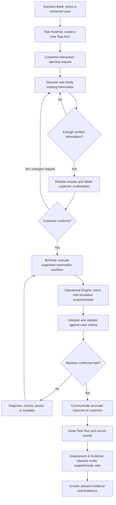

# DEIXEN — First Integrated Professional Task Map
## From a new customer booking request to a verified and accurately communicated reservation outcome

## 0. Why this map exists

This document pressure-tests the proposed DEIXEN architecture against one bounded professional task. It makes the responsibilities of Scenario Bank, Task Runtime, Customer Interaction, Terminal, the operational simulation engine, Coach, Assessment & Evidence, and Growth explicit at every stage.

The aim is not to design every screen or prescribe a final database schema. The aim is to find out whether the architecture can coordinate a real work task without:

- duplicating the case or operational truth;
- turning Task Runtime into a second GDS engine;
- confusing a virtual customer with Coach;
- allowing Coach instructions to contaminate the Terminal record;
- treating system acceptance as professional correctness;
- treating task completion as independent competence;
- forcing a task to finish when the correct professional action is to pause, clarify, decline, or escalate.

**Status:** This is a working task map for review and validation. It is not yet a researched, practitioner-approved case package or a final UX/UI specification.

## 1. The current task candidate and its deliberate boundary

### 1.1 Task under test

**Complete a new reservation for one adult traveller on one pre-selected, customer-confirmed, single-segment itinerary; ensure that the operational result matches the confirmed request and the verified task criteria; then communicate the outcome accurately to the customer.**

The bounded case assumes:

- one adult traveller;
- one passenger;
- one flight segment;
- one fare context within the currently verified training scope;
- a selected itinerary already supplied by the case from an authoritative, dated source or authorized environment;
- a customer who has chosen and confirmed that itinerary before the learner begins operational booking;
- one material piece of information may be missing from the initial customer request, but the exact field must be selected only after checking the current Verified Reference and practitioner requirements.

The task uses synthetic customer data. It must not use real passenger personal information.

### 1.2 Why the itinerary is pre-selected

The current verified implementation/slice evidence available to the project describes a narrow reservation workflow. This first architecture test should not silently assume that full flight search, availability interpretation, fare comparison, ticket issuance, payment, or airline-specific advice is already supported and verified.

Therefore, the chosen itinerary is a controlled input to this first case. If later research and Verified Reference review show that DEIXEN can safely include the search/advice stage, that can be added as a new task stage or a broader variant. It must not be invented here.

### 1.3 Explicitly outside this first test

Unless separately verified and approved, this map does **not** test:

- discovering or searching live availability;
- recommending/comparing multiple itineraries or fares;
- issuing a ticket, collecting payment, or processing a refund;
- exchanges, cancellations, disruptions, queues, or after-sales work;
- multiple passengers, multiple segments, complex passenger types, or special service requirements;
- voice-based customer dialogue;
- a full work shift or multi-customer queue.

These are not declared unimportant. They are excluded so that the first test can isolate the case-to-run, customer-to-terminal, and evidence hand-offs.

### 1.4 What the first test is meant to prove

It should demonstrate that DEIXEN can coordinate one coherent work task in which:

1. the customer request and relevant facts are understood;
2. missing information is clarified rather than guessed;
3. the customer confirms the agreed task scope;
4. the learner performs the supported operational workflow through Terminal;
5. genuine engine acceptance is distinguished from task-level correctness;
6. errors, mismatches, pauses, and recovery can be represented honestly;
7. learner support is mode-sensitive and recorded;
8. the final evidence says what happened and under what conditions, without overstating competence.

It does not, by itself, prove market readiness, broad transfer, or workplace readiness.

## 2. The central separation: three objects, three owners

| Object | What it represents | Owner | What it must not become |
|---|---|---|---|
| **Case Package** | The authored, versioned definition of the professional situation: customer facts, constraints, intended outcome, supported operations, variations, and criteria. | Scenario Bank / case-authoring process | A live learner session or a mutable booking record. |
| **Task Run** | One learner's attempt to perform one selected task/variant under a defined mode and support policy. | Task Runtime | A reusable case definition or an unqualified competence claim. |
| **Operational Session** | The isolated working state of the simulated GDS/booking environment for that attempt. | Operational simulation engine, bound to the run | A customer conversation state or a professional judgement record. |

Related but separate:

- **Conversation State** records what the customer and learner have said, which facts have been disclosed, and what the customer has confirmed.
- **Task State** records the task's current phase and allowed transitions.
- **Evidence Events** record observable actions and outcomes, with provenance and support conditions.

The Case Package is not edited when a customer discloses a hidden fact. The Task Run records that disclosure for this attempt. The Operational Session changes only through the operational engine's verified rules.

## 3. End-to-end map at a glance

This is a conceptual flow. It is not a claim that all branches or commands exist in the current application.

## 4. Stage-by-stage responsibility map

### Stage 0 — Discover and select the case

**Purpose:** The learner understands what kind of work is being requested before entering the active task.

| Responsibility | Definition |
|---|---|
| Customer information | Not yet active in the learner's interaction. Scenario Bank may show a short customer/task summary and the visible request context, but not hidden facts or answer-bearing details. |
| Learner action | Selects the case and reviews its purpose, broad scope, prerequisites, and current practice/assessment availability. |
| Scenario Bank | Displays the case family and the selected version/variant, purpose, prerequisite information, supported scope, and whether this is a practice or assessment-eligible case. It keeps hidden facts and protected assessment details concealed. |
| Terminal | No operational work yet. It should not create a booking or display invented Amadeus output before a run is launched. |
| Coach | May explain what the task is intended to teach, but must not reveal hidden customer facts or tell the learner the actions to perform. |
| Task Runtime | Not yet running the task. On launch, it receives the selected immutable case/package version, chosen variant, mode, and support policy. |
| Evidence recorded | Case selection and launch activity may be recorded for traceability. Selection alone is not competence evidence. |

**Exit condition:** The learner explicitly starts the case. The system creates a new Task Run; simply opening the case must not silently begin operational work.

### Stage 1 — Initialize the Task Run and brief the learner

**Purpose:** Establish an auditable attempt with the correct context and support conditions.

| Responsibility | Definition |
|---|---|
| Customer information | The case contains a synthetic customer profile and the authoritative request data. Only the information intended to be initially visible is presented at this point. |
| Learner action | Reads the task brief and understands the expected outcome and the boundaries of the work. |
| Scenario Bank | Supplies the case snapshot and version. It does not own the active attempt after launch. |
| Terminal | Opens the relevant work environment in the selected mode. The operational record starts clean for this run. |
| Coach | In supported practice, may explain how to use the learning environment and what kinds of help are available. It does not reveal the case solution. In assessment mode, no instructional Coach is available during the attempt. |
| Task Runtime | Creates a unique Task Run identity; binds case/version/variant, mode, support policy, customer-interaction state, and an appropriate operational session. It initializes task phase and event capture. It does not change the authored case package. |
| Evidence recorded | Run start, case/version, variant, mode, session identity, support policy, start timestamp, and any system initialization failure. These fields establish conditions; they do not prove competence. |

**Exit condition:** The task is active and the customer opening can be presented. If initialization fails, the run is marked as a system/setup interruption rather than a learner failure.

### Stage 2 — Receive the customer's opening request

**Purpose:** Understand the stated request before moving to operational work.

| Responsibility | Definition |
|---|---|
| Customer information | The customer gives the initial request and the facts deliberately disclosed at opening. The customer does not volunteer every detail automatically. |
| Learner action | Reads/listens, identifies the requested outcome, and responds appropriately. The learner may summarize what they understood or ask an initial question. |
| Scenario Bank | No longer controls the live dialogue. The case package remains the reference for what the customer knows and may disclose. |
| Terminal | May show the active task context and provide access to the work area, but no operational command is required merely because the task has started. No customer text is inserted into the Amadeus record. |
| Coach | In supported practice, can clarify the learning objective or explain the difference between customer dialogue and operational input. It should not supply the customer's hidden facts or dictate the next question. |
| Task Runtime | Starts the customer interaction, tracks the task phase, and passes the initial customer message to the learner-facing interaction. It ensures the dialogue is attached to this run, not to the case template or another learner's attempt. |
| Evidence recorded | Initial customer message/version, learner response, event times, and the context in which the response occurred. Communication quality is not inferred from a message existing; it requires observable criteria and a suitable rubric. |

**Exit condition:** The learner either proceeds to clarify the request or explicitly indicates that the request is understood. The task must not assume that silence or opening the Terminal means the learner understood.

### Stage 3 — Discover and clarify missing information

**Purpose:** Test whether the learner asks appropriate questions and avoids guessing.

| Responsibility | Definition |
|---|---|
| Customer information | The case distinguishes initially disclosed facts from facts that can be disclosed only after a relevant question. It also identifies missing, ambiguous, conflicting, and genuinely unknown information. |
| Learner action | Asks relevant questions, identifies gaps, detects conflicts, and avoids inventing or assuming material facts. The learner may ask for clarification more than once. |
| Scenario Bank | Owns the authored disclosure rules and the authoritative facts. It does not directly answer the learner during a live run. |
| Terminal | Remains available but must not encourage premature command entry. It should not display fake operational requirements or invent mandatory fields. |
| Coach | In supported practice, may offer a graduated prompt such as asking the learner to check whether all required information is available. A stronger hint may reveal more and must be logged. Coach must not impersonate the customer. |
| Task Runtime | Routes the learner's dialogue to Customer Interaction, receives the recognized intent/result, updates the attempt's conversation state, tracks disclosed facts and task-phase readiness, and keeps a trace of the exchange. It does not decide Amadeus field requirements. |
| Evidence recorded | Learner questions and responses, interpreted question/intent category, facts disclosed, unresolved gaps, whether clarification occurred before action, and any Coach prompt/hint exposure. A disclosure event itself is not a competence judgment. |

**Exit condition:** The task has enough verified information to formulate the agreed request, or a legitimate stop/pause/escalation condition is reached.

**Important guardrail:** The case author must not mark a field as mandatory merely because it sounds plausible. Any operationally required information must be supported by the applicable Verified Reference, authorized environment, and where relevant practitioner/policy evidence.

### Stage 4 — Restate the request and obtain customer confirmation

**Purpose:** Prevent the learner from booking a technically valid but misunderstood or unapproved request.

| Responsibility | Definition |
|---|---|
| Customer information | The customer can confirm, correct, or change the details of the request. Any correction must come from the case's defined facts and plausible customer knowledge. |
| Learner action | Restates the agreed task in clear terms, checks material details and constraints, and obtains confirmation before operational execution. |
| Scenario Bank | Defines the authoritative expected request, constraints, and allowed customer changes. It records the case design, not the live confirmation. |
| Terminal | May show a concise, separate task brief/confirmed request near the work area. It does not insert customer conversation into the operational transcript. |
| Coach | In supported practice, can explain why confirmation matters or prompt a self-check. It must not answer for the customer. During independent assessment it provides no such prompt. |
| Task Runtime | Records a confirmed-request snapshot or revision for the run. If the customer changes a material fact, the active request version is updated through an explicit event and the task returns to clarification/confirmation. It must not silently overwrite the original case package. |
| Evidence recorded | Learner's restatement, material details checked, customer confirmation/correction, request revision, and any support exposure. The customer's confirmation is contextual evidence, not proof that the learner's operational work is correct. |

**Exit condition:** Explicit customer confirmation of the request being executed. If confirmation is withheld or the request cannot be resolved, the task remains pending or ends through an honest stop/decline/escalation path.

### Stage 5 — Execute the reservation in Terminal

**Purpose:** Perform the supported operational workflow using the verified simulation engine.

| Responsibility | Definition |
|---|---|
| Customer information | The confirmed request and the facts needed for the bounded booking task are available as task context. Customer dialogue remains a separate channel. |
| Learner action | Enters the operational entries required by the verified task scope, interprets the responses, and continues or corrects the workflow as appropriate. |
| Scenario Bank | Does not execute commands or own booking state. Its case package provides the task objective, expected constraints, and reference/provenance links. |
| Terminal | Presents the operational workspace, receives learner entries, displays genuine engine responses, and shows task context separately. The record remains LTR/monospace and contains only learner entries, Amadeus output, and the one permitted labelled DEIXEN training line. |
| Coach | In supported practice, may provide hints or explanations according to the support policy. Coach text stays in a separate Coach area and never becomes Amadeus output or the DEIXEN training line. A hint may affect the independence status of the attempt and must be captured. No instructional help is available during protected independent assessment. |
| Task Runtime | Routes each learner entry to the operational engine, associates its result with the active Task Run, tracks task-phase transitions, and coordinates with the dialogue/task state. It does not generate, modify, or reinterpret Amadeus responses. |
| Evidence recorded | Exact learner entry, exact engine response/result reference, operational state transition, order and timing, errors/retries, relevant verified-reference version, support request/display/exposure, and whether the learner proceeded before customer confirmation. A valid engine response is an operational event, not automatically a qualifying action. |

**Exit condition:** The learner reaches the operational checkpoint defined by the case, or a failure/unsupported action/other stop condition requires recovery or escalation.

### Stage 6 — Interpret the system response and verify task correctness

**Purpose:** Determine whether the operational result is both system-valid and consistent with the customer's confirmed request.

| Responsibility | Definition |
|---|---|
| Customer information | The confirmed request and any customer-approved revision remain the comparison baseline. Customer satisfaction is not used as a substitute for operational checks. |
| Learner action | Inspects the relevant output/state, checks the details that matter to this task, identifies mismatches, and decides whether the result is ready to communicate or needs correction. |
| Scenario Bank | Supplies the versioned task acceptance criteria and the source/provenance for case facts. It does not infer new Amadeus rules at runtime. |
| Terminal | Displays the operational record and state produced by the engine. It may show a separate checklist/task context, but must not modify or falsify the underlying output. |
| Coach | During supported practice, may ask the learner to compare the result with the agreed request or explain a verified field. It must not assert an unverified rule. During assessment, no corrective prompt is given. |
| Task Runtime | Invokes the relevant task/evidence criteria against the actual engine state and confirmed request, then coordinates the next phase. It does not act as the evaluator by intuition; the criteria must be explicit, versioned, and grounded. |
| Evidence recorded | What the learner checked, what differences were detected, when they were detected, whether the system accepted the action, whether the final task state matched the agreed request, and the criteria/source versions used for comparison. Keep system acceptance and professional task correctness as separate fields/dimensions. |

**Exit condition:** The result meets all applicable verified task criteria, or a mismatch requires correction, pause, disclosure, or escalation.

**Critical test case:** If the operational engine genuinely accepts an action but the result conflicts with the customer's confirmed request, the engine response remains genuine. The task/evidence layer flags the mismatch; it must not fabricate a system rejection.

### Stage 7 — Recover, pause, decline, or escalate when necessary

**Purpose:** Represent the fact that professional work does not always proceed directly to completion.

| Responsibility | Definition |
|---|---|
| Customer information | The customer may clarify, correct, change, accept a limitation, or request an outcome the learner cannot safely provide. The case defines plausible reactions but does not reward pressure or overpromising. |
| Learner action | Diagnoses the issue, corrects it only through verified procedures, explains a material limitation, asks for information, pauses, declines to proceed, or escalates as appropriate. |
| Scenario Bank | Defines permitted branches and stop/escalation outcomes supported by the case and verified sources. |
| Terminal | Continues to expose authentic operational behavior. It must not convert an unsupported or invalid operation into a convenient success. |
| Coach | In practice, may support diagnosis and explain a recovery path after or during an allowed hint. It must distinguish verified procedure from general learning advice. In assessment, no rescue or corrective instruction is supplied. |
| Task Runtime | Tracks branch/loop state, preserves the sequence of prior events, prevents unapproved transitions, and returns the run to the appropriate earlier phase after a customer-request change or operational correction. It may close the run as paused/blocked/escalated/declined rather than forcing completion. |
| Evidence recorded | Error/mismatch, detection point, learner diagnosis, recovery action, whether the action was verified and appropriate, support exposure, customer communication, and the final branch/outcome. A recovery attempt is not erased because the final state later becomes correct. |

**Exit condition:** The task resumes at a justified phase, pauses, ends, or escalates. Never rewrite the event history so that a successful correction hides the original error.

### Stage 8 — Communicate the outcome and close the customer interaction

**Purpose:** Ensure that the customer receives an accurate account of what actually happened.

| Responsibility | Definition |
|---|---|
| Customer information | The customer receives the verified outcome and may react according to the case. A customer response is not automatically a judgement of the learner's competence. |
| Learner action | Explains the result, any relevant limitation or unresolved issue, and the next step. The learner must not promise ticket issuance, payment completion, or another action outside the task scope. |
| Scenario Bank | Defines plausible customer reaction rules and the expected scope of closure for this case. |
| Terminal | Remains the record of operational activity. Customer-facing communication is kept outside the Amadeus transcript. |
| Coach | During practice, may provide post-interaction feedback on clarity, accuracy, expectation management, and professional tone. During assessment, feedback waits until the attempt is closed and evidence is secured. |
| Task Runtime | Coordinates the closure event, checks that required task conditions are satisfied, and prevents a final status from being set merely because the learner sent a message. |
| Evidence recorded | Learner's closing communication, factual accuracy against the verified operational result, disclosure of limitations, next-step clarity, customer response/reaction, and the reason for the customer reaction if authored by the case. Customer satisfaction remains a separate experience outcome. |

**Exit condition:** The interaction is closed appropriately, or an explicit unresolved/paused/escalated outcome is recorded.

### Stage 9 — Debrief, evidence interpretation, and Growth

**Purpose:** Explain what the attempt demonstrated without confusing completion, correctness, and independence.

| Responsibility | Definition |
|---|---|
| Customer information | The customer dialogue is part of the run record and may be summarized only as needed for the learner's debrief. It is not an instructional authority. |
| Learner action | Reviews what happened, reflects on significant decisions/errors, and identifies a useful next learning action. |
| Scenario Bank | Retains the case definition/version and its criteria provenance; it does not rewrite the learner's attempt. |
| Terminal | Makes the operational record available for review while preserving its strict transcript content. |
| Coach | Provides explanatory feedback after the run is closed and the evidence snapshot is secured. It distinguishes verified operational facts, professional judgement criteria, and general learning advice. |
| Task Runtime | Finalizes the run outcome, freezes the attempt event sequence, and hands the run context to Assessment & Evidence. It does not declare independent competence on its own. |
| Evidence recorded | Final task outcome, criteria results, operational correctness, judgement/communication observations, errors and recovery, support exposure, task variant, session isolation, provenance, and any known gaps or system limitations. Calculated competency interpretations are derived from recorded events and rules; they are not raw facts. |

**Exit condition:** The attempt is closed, evidence interpretation is complete to the extent supported, and Growth can display an appropriately limited summary.

## 5. Coach policy by experience mode

Coach should not behave identically in every part of the learner journey.

| Mode / moment | Coach role | Must be kept separate from | Evidence/independence implication |
|---|---|---|---|
| **Ghost demonstration** | Narrates what happens, why a step matters, and what to notice; uses selective reflection prompts. | Terminal operational record and the virtual customer. | Ghost exposure is learning exposure, not independent performance evidence; preserve D97. |
| **Supported practice** | Explains concepts, offers hints, points out relevant checks, and provides corrective feedback according to the selected support level. | Customer facts and operational truth. | Every meaningful support exposure is recorded; the attempt is practice, not independent evidence. |
| **Integrated scenario practice** | Supports professional reasoning and task execution selectively; may respond to learner requests. | Customer dialogue and system output. | Help affects the conditions under which the task was performed and must remain visible in evidence interpretation. |
| **Reduced-support practice** | Offers less frequent/general prompts; encourages self-checking and learner diagnosis. | Supplying undisclosed customer facts or unsupported operational claims. | Record whether help was available, requested, shown, or used. |
| **Independent assessment** | No instructional hints, answer-giving, Ghost, or corrective Coach intervention during the attempt. Post-attempt feedback is allowed only after evidence is secured. | Entire in-attempt assessment chain. | Any prohibited assistance exposure must prevent the affected attempt from qualifying as independent, while preserving the completed-attempt record. |
| **Post-attempt debrief** | Explains performance and gaps using verified references and the recorded events. | Retrospective alteration of the attempt record. | Feedback is separate from the already secured evidence. |

A customer answering a legitimate question is not Coach assistance. Customer disclosure is part of the scenario. However, the customer must not volunteer hidden information merely to rescue the learner from a poor question unless that is explicitly how the case is designed and assessed.

## 6. What the Task Runtime actually owns

Task Runtime is an orchestrator, not a generic intelligence layer. Its proposed responsibilities are:

1. **Start a run:** create a unique attempt and bind it to one immutable case/version/variant and a mode/support policy.
2. **Bind specialist states:** connect the attempt to the appropriate Customer Interaction state and isolated Operational Session.
3. **Manage phase transitions:** allow only the transitions defined for the case and current mode.
4. **Route events:** pass customer messages to the conversation capability and learner operational entries to the verified operational engine.
5. **Maintain context links:** ensure the agreed customer request, current task phase, and operational session are associated with the same attempt.
6. **Record the event sequence:** preserve order, actor, time, source, and support conditions.
7. **Coordinate evaluation:** send the relevant case criteria and observed outcomes to Assessment & Evidence; do not make unsupported judgements itself.
8. **Handle branches:** support clarification loops, changed requests, correction, pause, decline, escalation, and resumption where the case permits.
9. **Close and freeze a run:** prevent later debrief or Growth calculations from silently rewriting the original attempt.

Task Runtime must not:

- author or mutate the Scenario Bank's master case;
- generate Amadeus commands, responses, errors, or state transitions;
- decide which passenger fields or booking actions are mandatory without verified criteria;
- invent customer facts or reveal facts contrary to the case disclosure rules;
- provide Coach content or assess professional performance by free-form impression;
- convert a valid engine response into an artificial rejection;
- transform a completed assisted run into independent evidence;
- prescribe one screen layout or require all components to be visible simultaneously.

## 7. Evidence: what is recorded, what is interpreted, and what is not proven

### 7.1 Event capture is not yet evidence qualification

The system should preserve observable events first. Assessment & Evidence then interprets them against the case criteria, mode policy, support exposure, and task provenance.

For this task, the following event families are likely to matter:

| Event family | Example of what is recorded | What it may support | What it does not prove by itself |
|---|---|---|---|
| **Run context** | Case/version, variant, mode, run/session identity, start/end, support policy. | Integrity and comparability of the attempt conditions. | Competence. |
| **Customer discovery** | Learner question, recognized intent/category, fact disclosed, unresolved ambiguity. | Information gathering and clarification behavior when mapped to a reviewed rubric. | That the learner understood every operational requirement. |
| **Request confirmation** | Learner restatement, customer correction/confirmation, request revision. | Confirmation and expectation-management behavior. | Correct booking execution. |
| **Operational action** | Learner entry, exact engine response, state transition, source/version provenance. | Operational sequence, response interpretation, and recovery observations. | Professional correctness merely because the engine accepted an entry. |
| **Judgement/decision** | Proceed, pause, ask, correct, decline, or escalate; relevant context. | Professional judgement against explicit criteria. | A broad competence claim from one decision. |
| **Support exposure** | Coach/hint availability, request, display, content/category, timing, exposure. | Independence conditions and the degree/type of assistance. | That the learner actually relied on every displayed hint; exposure and use should be distinguished. |
| **Validation** | Checks performed, mismatch found, detection timing, final comparison. | Verification and error-detection behavior. | Reliable transfer across new tasks. |
| **Recovery** | Error, diagnosis, correction, retry, escalation, outcome. | Error management and recovery behavior. | That the original action was correct. |
| **Customer communication** | Learner's explanation, stated limitations, next step, customer response. | Communication behavior under a reviewed rubric. | Operational accuracy or professional correctness by customer satisfaction alone. |
| **Closure** | Final task outcome, unresolved items, closure conditions. | Whether this attempt reached its defined task outcome. | Independent competence, retention, or workplace readiness. |

### 7.2 Keep separate dimensions separate

At minimum, the evidence interpretation should distinguish:

- operational validity/accuracy;
- alignment with the confirmed customer request and task criteria;
- information gathering and professional judgement;
- customer-facing communication;
- error detection and recovery;
- independence and support conditions;
- task outcome;
- customer experience/reaction.

Do not combine these into one percentage, readiness score, or simple pass/fail impression. Existing learner-facing status vocabulary remains governed elsewhere; this map does not introduce new displayed statuses.

### 7.3 Candidate attempt metadata

Without freezing a schema, the run should be able to identify:

- learner/attempt reference appropriate to the current privacy and account model;
- case family, case package version, and variant;
- mode and support policy;
- operational session identity and initial state;
- conversation-state identity;
- event timestamps and event order;
- current verified-reference identifiers/versions relevant to operational claims;
- help/hint exposure and whether it occurred before or after the action;
- run outcome and unresolved/system-error limitations.

Use data minimization. The first prototype should use synthetic customer data. Do not store unnecessary real personal data or raw audio; voice is outside this task map.

### 7.4 Recorded versus calculated information

Recorded events and source-linked results are the evidential foundation. Calculated skill interpretations, independence conclusions, and Growth summaries should be derived from recorded evidence and explicit rules. Do not store a calculated label as though it were an observed fact. This aligns with the existing architecture's recorded-versus-calculated evidence principle; detailed persistence design remains out of scope here.

## 8. Task outcome and internal state

A professional task does not always end in a successful reservation. The internal runtime must represent outcomes truthfully.

Possible internal terminal outcomes to test include:

- **Completed as requested:** the task criteria are met and the result matches the confirmed request.
- **Ended with unresolved mismatch:** the system produced a result, but it does not meet the agreed task criteria; the run does not count as completed-as-requested and may require correction or an honest stop.
- **Paused / awaiting information:** material information is missing or needs confirmation.
- **Blocked by unsupported scope:** the learner's next step is outside the verified simulation boundary.
- **Escalated:** the appropriate outcome is to hand the issue to an authorized person or process.
- **Declined / not proceeded:** the learner appropriately stops rather than make an unsafe or unsupported promise/action.
- **Abandoned / interrupted:** the learner or system ends the run before a task outcome is reached.

These are candidate **internal** runtime outcomes, not replacements for the current learner-facing statuses **Completed / In progress / Needs more practice** and not a newly approved status taxonomy. The final model needs owner review and case testing.

## 9. Branches and failure cases the architecture must survive

| Situation | Required behavior | Runtime / evidence consequence |
|---|---|---|
| Missing material information | Learner asks an appropriate question; customer reveals only the facts allowed by the case. | Return to clarification; record the question, disclosure, and any support. |
| Ambiguous or conflicting information | Do not guess. Ask, verify, pause, or escalate according to the case. | Keep unresolved ambiguity visible; no operational transition until required conditions are met. |
| Customer changes a confirmed detail | Customer change is an explicit event; learner restates and reconfirms the revised request. | Create a new request revision in the run; do not mutate the master Case Package. Revalidate the operational state against the new request. |
| Engine rejects an entry | Show the authentic verified response and follow the applicable recovery path. | Preserve input/response/state; do not silently coerce or rewrite the learner entry. |
| Engine accepts an action that conflicts with the customer request | Keep the authentic system response; identify the task-level mismatch separately. | Record system acceptance and professional/task mismatch independently. |
| Learner enters unsupported/out-of-scope behavior | Do not invent a success or an Amadeus response. Explain the boundary honestly. | Mark the run as unsupported-scope or route to a supported alternative; avoid penalizing the learner for unimplemented behavior. |
| Customer declines or does not confirm | Do not proceed with a task that depends on confirmation. | Wait, clarify, pause, decline, or close according to the case. |
| Coach help is used in practice | Show help according to practice policy and keep it separate from customer/system channels. | Record availability, request, exposure, timing, and help type. |
| Coach/hint leaks into an assessment attempt | Do not erase the attempt. The learner may complete it, but the affected attempt cannot qualify as independent when prohibited help was exposed. | Preserve the non-qualifying run and explain the evidence limitation after closure. |
| Browser/device/system interruption | Preserve only what is safely recoverable under the approved persistence model; never fake a completed task. | Record interruption/system uncertainty. Resume rules need separate design and testing. |
| Customer dissatisfaction despite correct work | Represent the customer's reaction and reason fairly; do not automatically label the learner incompetent. | Keep customer experience separate from operational and professional criteria. |
| Customer satisfaction despite incorrect or misleading work | Do not let positive reaction compensate for a mismatch or unethical behavior. | Task correctness and professional criteria remain controlling. |

## 10. Relationship to the independent assessment variant

The supported-practice map above is not itself an independent assessment specification. Assessment should reuse the same **task family and responsibility boundaries**, but it must not simply replay the exact case the learner has already rehearsed.

A candidate assessment arrangement:

1. Scenario Bank identifies an assessment-eligible case family and a sufficiently distinct, unpractised variant.
2. The assessment launch creates a new Task Run and a fresh isolated Operational Session with clean booking state.
3. The assessment run binds only to its own case snapshot, conversation state, and session. Earlier practice events are not merged into its qualifying evidence chain.
4. The assessment session has no Ghost exposure, Coach instruction, hints, or corrective rescue during the attempt, consistent with D97 and its exposure/independence rules.
5. Normal customer answers to legitimate questions remain part of the task and are not treated as prohibited help.
6. Evidence is interpreted only from events in the same assessment chain, against explicit criteria and the chosen variant.
7. Feedback is provided only after the attempt and evidence snapshot have been secured.
8. If the task is completed but prohibited help, contamination, missing events, or other qualification conditions occur, preserve the attempt but do not label it qualifying independent evidence.

**Important:** the exact D97 wording and current canonical status must be checked against the authoritative current `07` decision log before this map is converted into specifications. This document does not revise D97.

## 11. What this first task tests — and what it cannot prove

### It can pressure-test

- the Scenario Bank → Task Run hand-off;
- whether an immutable case definition can be separated from the active run;
- whether Customer Interaction can disclose facts without owning operational state;
- whether Terminal can remain the operational center while the dialogue stays distinct;
- whether the Task Runtime can coordinate phase changes and loops without duplicating domain engines;
- whether the task distinguishes engine-valid from professionally/task-correct;
- whether Coach support can be mode-sensitive and recorded;
- whether a task can pause, recover, or escalate honestly;
- whether events can support a meaningful post-attempt debrief and evidence interpretation;
- whether the same task family can later support an isolated independent assessment variant.

### It cannot prove

- that the customer conversation model covers natural language sufficiently;
- that a deterministic dialogue engine is better than an LLM for all cases;
- that every reservation/ticketing workflow is supported;
- that flight search, live availability, fare comparison, ticketing, payment, exchanges, or disruptions are implemented or verified;
- that the task is representative of all entry-level jobs in Saudi Arabia, Oman, or the UAE;
- that one successful simulation proves retention, transfer, or workplace readiness;
- that a particular screen layout is usable or visually final;
- that the proposed data contracts are the final code architecture.

## 12. Acceptance criteria for the architecture test

The architecture test is successful only if all relevant criteria can be demonstrated with the same bounded case and a realistic learner flow.

### Case and run integrity

- [ ] The learner selects a specific, versioned Case Package.
- [ ] Launch creates one distinct Task Run; merely viewing a case does not start a run.
- [ ] The active run references an immutable case snapshot/version.
- [ ] Customer facts disclosed during the run do not mutate the master Case Package.
- [ ] The Operational Session and Conversation State are associated with the correct Task Run but remain separate from one another.

### Operational truth and task correctness

- [ ] Terminal entries are processed only by the approved operational simulation engine.
- [ ] Operational responses/state transitions are genuine outputs of the verified engine, not authored convenience text.
- [ ] Unsupported behavior is not fabricated as success.
- [ ] An engine-accepted but professionally/task-inconsistent action remains visibly accepted by the engine and is separately identified as a task mismatch.
- [ ] Task criteria are explicit, versioned, and grounded in verified references/practitioner-approved case facts.

### Experience and support boundaries

- [ ] Customer dialogue is separate from the Terminal operational record.
- [ ] Coach is separate from the customer and from Amadeus output.
- [ ] The Terminal record remains LTR/monospace and restricted to learner entries, Amadeus output, and the one permitted labelled DEIXEN training line.
- [ ] Coach support follows the run's mode/support policy and is recorded.
- [ ] The task can loop, pause, decline, or escalate without forcing completion.

### Evidence and assessment integrity

- [ ] Events preserve order, source, actor, time, run identity, and relevant case/reference versions.
- [ ] Support exposure is distinguishable from help request and actual use where the system can observe the distinction.
- [ ] Task completion is not automatically interpreted as independent competence.
- [ ] Customer satisfaction is not used as a substitute for operational correctness or professional judgment.
- [ ] An independent assessment attempt is isolated, uses a distinct unpractised task variant, and satisfies D97; prohibited help/contamination prevents qualifying independent evidence.
- [ ] Growth receives evidence and limitations, not an invented score or a raw success flag presented as competence.

A failed criterion should be reported as an architecture or prototype gap, not hidden by simplifying the scenario.

## 13. Open design questions exposed by this task

1. What is the smallest set of customer facts the learner should see before asking questions, and which fact is sufficiently meaningful to reveal only after a relevant question?
2. Which exact customer-data fields are required by the verified operational workflow, and which are policy-/case-dependent rather than universal?
3. Should customer dialogue and Terminal appear side-by-side, sequentially, or in an adaptive workspace? This is a UX prototype question, not an architecture assumption.
4. What is the minimum task-state vocabulary the runtime needs internally, without exposing too many statuses to the learner?
5. Which transitions are deterministic and which require a human-authored case branch?
6. How should deterministic dialogue handle paraphrases, misunderstood questions, and unsupported requests without frustrating beginners?
7. What is the appropriate correction path after an engine-accepted but task-inconsistent action?
8. What counts as an observable professional communication behavior, and which rubric needs practitioner review?
9. How does the system recover safely from a device/session interruption without creating ambiguous or duplicated evidence?
10. What task variation is sufficiently different to test independent performance while preserving comparable task demand?
11. Which parts of the end-to-end customer journey should be added only after this bounded booking flow is validated?
12. How should Home and Growth communicate a learner's next step without implying a job-readiness determination?

## 14. Required evidence and validation before detailed UX/UI specification

Before this map becomes a detailed specification, complete these checks:

1. **Operational reference check:** verify every required field, command, system response, state transition, task prerequisite, and permitted correction against the current approved Amadeus Verified Reference and authorized training environment. This document deliberately includes no Amadeus command syntax or invented responses.
2. **Case review:** have an experienced reservation/ticketing practitioner review the request, constraints, task outcome, plausible customer disclosures, and stop/escalation branches.
3. **Customer dialogue prototype:** test a small, bounded interaction with real beginner phrasing. Record misunderstanding, repeated questions, inappropriate disclosure, and authoring effort.
4. **Learner flow prototype:** test whether beginners understand the difference between customer dialogue, Terminal, Coach, task context, and the next action.
5. **Evidence review:** have a separate reviewer inspect the event sequence and determine whether the claimed observations are actually supported.
6. **Assessment isolation test:** demonstrate a clean, distinct attempt and show that prohibited support or contamination cannot silently qualify.
7. **Scope audit:** verify that the task tests the intended capabilities and does not accidentally depend on unimplemented search, fare, ticketing, or service flows.

## 15. Recommended next step after this map

The next deliverable should be a **Case Package Definition for this one task**, not a screen specification or code ticket. It should contain only:

- synthetic customer profile and source facts;
- initial disclosure and hidden/disclosable information;
- confirmed request and constraints;
- selected itinerary provenance and verification status;
- the exact operational scope supported by the current Verified Reference;
- allowed customer changes and dialogue branches;
- task acceptance, stop, pause, and escalation criteria;
- practitioner-reviewed professional behavior criteria;
- one supported-practice variant and a plan for a structurally distinct assessment candidate;
- evidence events and support policy.

Only after that Case Package is validated should DEIXEN decide whether the UX model and Task Runtime responsibilities need adjustment, and then create detailed UX/UI specifications. Implementation remains a separate, explicitly authorized step.

---

**End of working task map.**

## Appendix A — CP-001 case choices and pressure-test findings (7 November 2026)

The detailed Case Package Definition is `09 — DEIXEN Case Package Definition — New Reservation.md`.

The previously open “missing customer fact” candidate is now provisionally instantiated as the passenger mobile number. The value is held until the learner asks an appropriate question and the customer permits disclosure. The agency contact value remains a separate case/work-context fact. This is a case design choice, not a claim that every agency must collect or store information in precisely this way; practitioner review is pending.

### Operational-reference qualification

- The case reuses the synthetic main-task fixture: one adult, RUH–DXB, 6X 403, class Y, one segment, dynamic task date, AP agency contact, TKOK, RF requester, ER, and FXP.
- The current live Verified Reference snapshot is third edition V-01–V-18. The passenger contact SSR suffix issue remains U-12, and the AP/PRINT Phone mapping remains U-14. CP-001 must not release the bare-number CTCM expectation or teach AP=PRINT Phone as a verified universal rule.
- FXP is stored pricing/TST, not ticket issuance.

### Material architecture finding

The current app's RF handler accepts any non-empty text without checking it against the case's actual requester; the current FXP handler's operational completion flag follows a filed booking plus accepted FXP. Runtime/Assessment therefore requires a case-level semantic validator and separate outcomes for operational completion, task consistency, and qualifying evidence. The engine's accepted RF response must not be rewritten as an Amadeus rejection.

This finding adds a concrete validation requirement to the map; it does not change D92/D97 or authorize implementation. See CP-001 Sections 6–10 for the detailed stage responsibilities, source gates, and branch catalogue.
